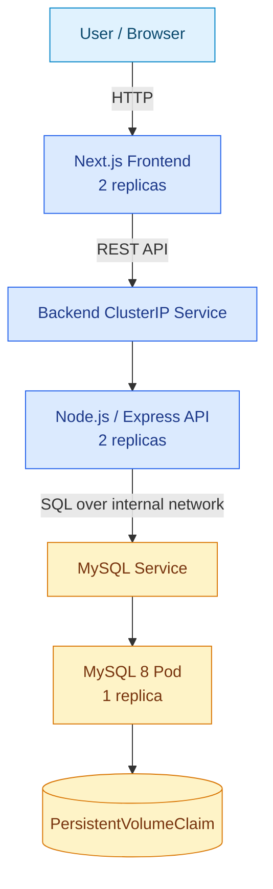
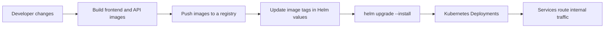

<div align="center">


  

</div>

---

# Containerized Employee Management Platform

A practical cloud-native learning project that packages a small employee-management application into containers and describes how to run it on Kubernetes. The current application stack is **Next.js frontend + Node.js/Express API + MySQL** (despite the repository name, this is not a MongoDB-based MERN stack).

[**Source code**](https://github.com/AhmedRaza92110/mern-app-devops-project) · [Kubernetes manifests](k8s/) · [Helm chart](helm/mern-app/)

## At a glance

| Layer | Current implementation | Why it is used |
|---|---|---|
| Web UI | Next.js | Component-based UI and production build support |
| API | Node.js, Express, mysql2 | Lightweight REST API between UI and relational data |
| Data | MySQL 8 | Relational storage for employee records |
| Packaging | Dockerfiles, multi-stage frontend image | Repeatable runtime environments and smaller frontend runtime image |
| Orchestration | Kubernetes Deployments and Services | Desired-state management, service discovery, replica management |
| Application packaging | Helm chart | Parameterized releases and reusable Kubernetes templates |
| Persistent data | PersistentVolumeClaim manifest | Separates database data from the lifecycle of a pod |

## 🏛️ Application architecture



## 🔁 Delivery and deployment model

The repository contains Kubernetes manifests and a Helm chart. A GitHub Actions pipeline is **not currently present in this repository**, so image build/push and cluster deployment should be treated as manual steps until a CI/CD workflow is added.



The flow above is the recommended delivery workflow; only the manifests and chart are checked into this repository. Configure a registry and cluster before using the workflow.

## 🧱 Kubernetes resources

- `k8s/namespace.yaml` — application namespace.
- `k8s/frontend-deployment.yaml`, `k8s/frontend-service.yaml` — web tier.
- `k8s/backend-deployment.yaml`, `k8s/backend-service.yaml` — API tier.
- `k8s/mysql-deployment.yaml`, `k8s/mysql-service.yaml`, `k8s/mysql-persistent.yaml` — database and persistence.
- `helm/mern-app/` — reusable chart templates and values.
- `rendered.yaml` — rendered Kubernetes output for inspection.

## 💡 Why this infrastructure?

- **Separate Deployments:** frontend and API can be rolled out and scaled independently.
- **ClusterIP for internal tiers:** database and API traffic should stay inside the cluster rather than being exposed directly to the public internet.
- **Persistent storage for MySQL:** database files should survive pod replacement; for serious environments, use a managed database or a carefully operated persistent storage class.
- **Helm values:** image tags, replicas and service configuration can be changed without duplicating all manifests.
- **Resource and health controls:** add readiness/liveness probes, CPU/memory requests and limits, and rollout checks before considering this production-ready.

## ▶️ Local development

Prerequisites: Docker, Node.js/npm, and (for Kubernetes) kubectl plus a local cluster such as kind or minikube.

1. Review the frontend and backend Dockerfiles and the Kubernetes manifests.
2. Build the images using the repository's Dockerfiles and tag them to match the manifest/chart values.
3. Load or push the images to a registry accessible by your cluster.
4. Apply the namespace and resources, or install the chart after checking its values.
5. Verify pods, services, and application logs with `kubectl get pods,svc -n mern-devops` and `kubectl logs`.

Exact commands depend on whether you're using Docker Desktop Kubernetes, kind/minikube, or a remote cluster; don't apply the manifests to a production cluster without reviewing the image names and credentials first.

## 🔐 Security and production-readiness checklist

- [ ] Remove any committed `.env` file and rotate credentials if real values were ever pushed. Use Kubernetes Secrets or a managed secret store.
- [ ] Replace hard-coded database credentials in Kubernetes YAML and use a least-privilege database user (not MySQL root).
- [ ] Keep database and API services private; expose only the required web entry point through Ingress/load balancing.
- [ ] Pin image versions/digests rather than relying on mutable tags.
- [ ] Add probes, resource requests/limits, NetworkPolicies, TLS, backups and restore testing.
- [ ] Add CI for tests, image builds, vulnerability scanning and controlled deployment.

> **Portfolio status:** This repository demonstrates containerization, Kubernetes resources and Helm packaging. CI/CD, hardened secrets, production ingress, and operational monitoring should only be described as implemented after they are configured and tested.

## Repository layout

```text
backend/             Node.js API and Dockerfile
frontend/employee/   Next.js frontend and Dockerfile
k8s/                 Raw Kubernetes manifests
helm/mern-app/       Helm chart and values
rendered.yaml        Rendered manifest output
```

<div align="center"><sub>Built as a hands-on Cloud & DevOps portfolio project.</sub></div>
